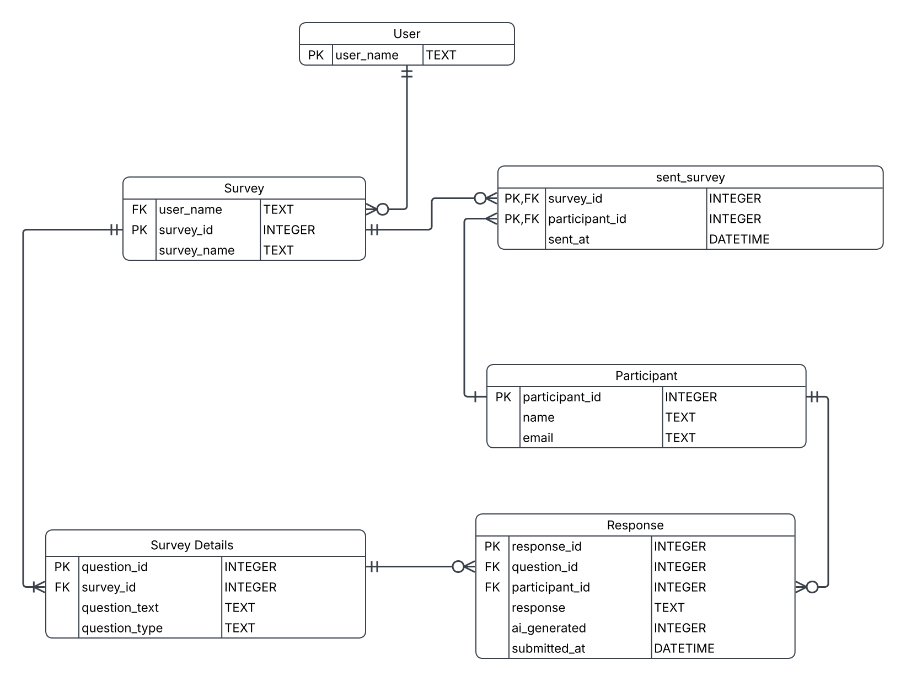

# Survey Response Database

A relational database for creating surveys, sending them to participants and
collecting their answers, including a flag for answers that look
AI-generated. Built in SQLite as a team project for a university database
design course (Fall 2026), then extended with sample data and example
queries.



## What it stores

| Table | Holds | Key |
|---|---|---|
| `User` | People who create surveys | `user_name` |
| `Survey` | A survey and the user who owns it | `survey_id` |
| `Survey_details` | The questions in each survey, with their type (text, rating, ...) | `question_id` |
| `Participant` | People who receive surveys | `participant_id` |
| `sent_survey` | Which survey went to which participant, and when | (`survey_id`, `participant_id`) |
| `Response` | One participant's answer to one question | `response_id` |

**Relationships:** a user owns many surveys; a survey has many questions; a
survey is sent to many participants and a participant can receive many
surveys (`sent_survey` links the two); each question collects many
responses, and each response belongs to one participant.

## Design decisions

- **`sent_survey` uses a two-column primary key** (`survey_id`,
  `participant_id`). It turns the many-to-many relationship between surveys
  and participants into its own table, and the combined key means a survey
  can only be sent to the same person once.
- **Questions live in their own table** instead of as columns on `Survey`,
  so a survey can have any number of questions, and every answer points to
  exactly one question.
- **`ai_generated` is a 0/1 flag with a `CHECK`**, defaulting to 0. SQLite
  has no boolean type, so the constraint keeps the column from holding
  anything but yes or no, and lets queries measure how many answers were
  flagged.
- **Timestamps on both ends** (`sent_at`, `submitted_at`) make it possible
  to measure response time and send reminders.

## Try it

Requires [SQLite](https://sqlite.org) (preinstalled on macOS and most Linux).

```bash
sqlite3 survey.db < schema.sql
sqlite3 survey.db < sample_data.sql
sqlite3 -header -column survey.db < queries.sql
```

The sample data is made up: 2 surveys, 5 questions, 5 participants, 12 answers.

## Example queries

All in [`queries.sql`](queries.sql). Output with the sample data:

**Response rate per survey**

```
survey_name             sent_to  responded  response_rate_pct
----------------------  -------  ---------  -----------------
Study Habits 2026       4        3          75.0
Campus Dining Feedback  3        2          67.0
```

**Share of answers flagged as AI-generated**

```
survey_name             answers  ai_flagged  ai_pct
----------------------  -------  ----------  ------
Study Habits 2026       8        1           13.0
Campus Dining Feedback  4        1           25.0
```

**Who hasn't responded yet** (for reminders)

```
survey_name             name          email
----------------------  ------------  -----------------
Campus Dining Feedback  Sam Patel     sam@example.com
Study Habits 2026       Casey Morgan  casey@example.com
```

**Average of numeric questions**

```
question_text                           average  answers
--------------------------------------  -------  -------
How many hours do you study per week?   13.3     3
Rate the dining hall food from 1 to 5.  3.0      2
```

## What I'd improve next

A review of the original design found a few gaps:

1. **Answers aren't tied to who received the survey.** `Response` checks
   that the participant and the question exist, but not that the survey was
   actually sent to that participant. A trigger, or a foreign key through
   `sent_survey`, would close that gap.
2. **Duplicate answers are possible.** Nothing stops the same participant
   from answering the same question twice; `UNIQUE (question_id,
   participant_id)` would.
3. **`email` should be required and unique**, so one person can't appear as
   two participants.
4. **`question_type` accepts any text.** A `CHECK` listing the allowed types
   (`text`, `number`, `rating`, `yes_no`) would catch typos.
5. **Naming consistency.** One foreign key refers to `survey_details` while
   the table is `Survey_details` (SQLite ignores case, stricter databases
   may not), and `User` is a reserved word in PostgreSQL; `app_user` would
   be more portable.

## Team

- America Fitch
- _Partner name_
- _Partner name_

Sample data, example queries and the design review were added by America
Fitch after the course.
